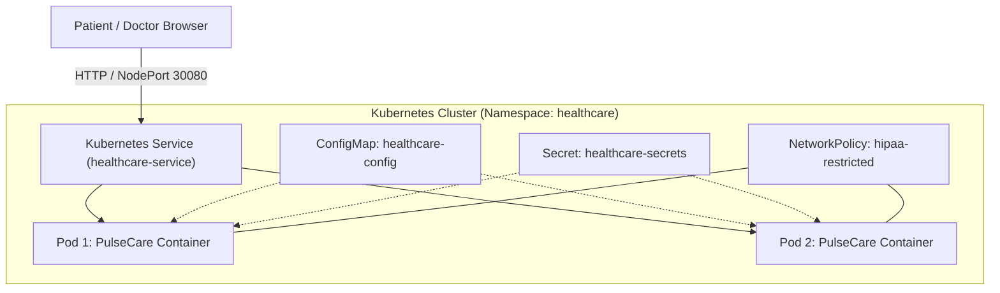
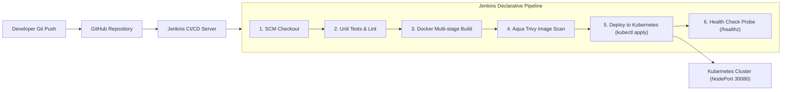
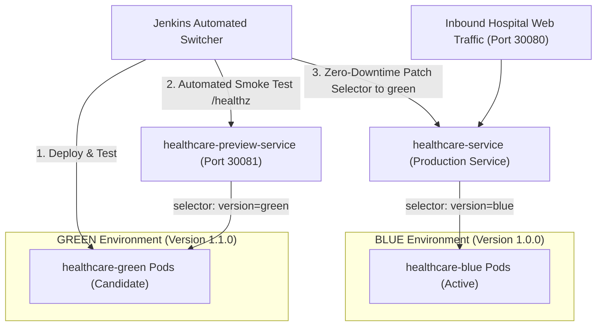
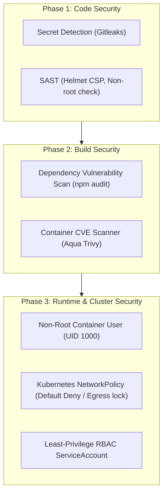

# System & DevOps Architecture Documentation

## 1. High-Level System Architecture

---

## 2. PBL-7: Docker & Kubernetes CI/CD Pipeline (Jenkins)

---

## 3. PBL-8: Automated Blue-Green Zero-Downtime Deployment Strategy

---

## 4. PBL-9: Healthcare DevSecOps Security Matrix (HIPAA Aligned)

